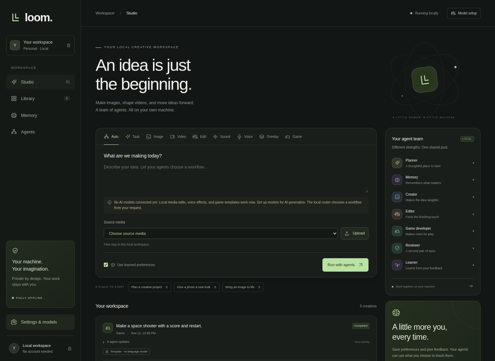

# Loom — Local AI Studio

A local desktop creation studio for Windows, with specialist workflows for tasks, code, images, video, sound, voices, small games, and transparent OBS animations. It keeps projects, feedback, and memory on your machine. There are no cloud inference providers or runtime model downloads.

**Delivery status:** runnable source and a Windows installer build are included. A compiled Windows installer is **not** included in this source download. This project was developed and tested on Linux; Windows packaging and real model inference still need testing on the target PC. See [INSTALL_WINDOWS.md](INSTALL_WINDOWS.md) for the Windows build and installation process.



## What works

| Feature | Without AI model files | With installed local models |
|---|---|---|
| Tasks and programs | Clearly labelled task-brief template | Ollama plans, writes, reviews, and produces downloadable code snippets |
| Image creation | Requires a local image model | SD 1.5 / SDXL text-to-image or reference-image inspiration |
| Image editing | Resize, crop, rotate, grayscale, brightness, contrast, sharpen | Image-to-image generation through the Image workflow |
| Video creation | Turn an image into an animated MP4 | Short text-to-video or compatible neural image-to-video clips |
| Video editing | Trim, resize, change speed, mute, clean soundtrack | No model needed |
| Sound cleanup | Local high-pass, low-pass, noise reduction, loudness normalization | No model needed; this is filter-based cleanup |
| Voice changing | Pitch, speed, optional denoise and normalization | Not neural identity cloning |
| Voice models | Requires local voice model files | Piper offline text-to-speech from an ONNX voice and companion JSON |
| Games | Playable Snake and space-game starter templates | Local language model writes a self-contained HTML5 game |
| Transparent OBS animations | Animate a transparent image; optional explicit solid-colour keying | No model needed |
| Exports | PNG, JPEG, WebP, GIF, BMP, TIFF; WAV, MP3, FLAC, OGG, M4A; MP4, WebM, MOV | Actual local conversion, not file renaming |

The app generates source code; it does not execute generated programs, compile Windows executables, or control arbitrary applications. Game exports include `game.html`, `Play.cmd`, and a README, and run in a Windows browser. They are not native compiled games.

Lyrics can be written through the Task workflow using the local language model. **Instrumental generation, sung songs, music-model training, and neural voice cloning are not implemented.** They require additional dedicated model integrations and local weights. Piper generates spoken speech, not singing.

RAW camera formats and every possible photo codec are not supported. JPEG/BMP flatten transparency; GIF has binary transparency; MP4/MOV and ordinary video exports are opaque. Use the Overlay workflow's WebM export for OBS alpha.

## Windows desktop installation

The app's **Downloads** link opens `/download`, with the source ZIP, its SHA-256 checksum, and setup guides. These are real local downloads. The page clearly marks the compiled Windows installer as pending until an installer distribution is supplied; no public website is deployed. Source bundles exclude personal media, memory, settings, model files, and caches.

Once a Windows build has been produced, keep `LoomStudio-Setup.exe` together with its numbered `.bin` companions and launch Setup. It installs per user, creates shortcuts, and opens a native desktop window. Python is bundled. GPU inference libraries, FFmpeg, Piper, and the offline WebView2 installer are included by the default build. User-selected diffusion and voice weights and Ollama's text model files are separate.

The full GPU payload is large. One installer launch does not mean that several gigabytes of neural model weights are already included. Model locations can be set in the app's Settings; missing engines and models are reported explicitly.

Builds can be produced on Windows with `packaging/build-windows.ps1`, or using the included GitHub Actions workflow after placing this source in a repository. The workflow must run successfully before there is an install-ready download. [Windows build details](INSTALL_WINDOWS.md).

## Run from source

Requires Python 3.11+ and local `ffmpeg` and `ffprobe` on PATH. From this directory:

```sh
python -m venv .venv
# Activate the virtual environment for your shell first.
python -m pip install -r requirements.txt
python -m studio.main
```

Open `http://127.0.0.1:8765`. This launches the same UI as the desktop version in a browser. For the native desktop shell, install `requirements-desktop.txt` and run `python desktop.py`. The Windows installer bundles the browser runtime; source users need an appropriate pywebview runtime.

On Windows, data defaults to `%LOCALAPPDATA%\LoomStudio`; on other systems it defaults to `~/LoomStudio`. `LOOM_DATA_DIR` overrides it. Settings, SQLite memory/job history, outputs, and desktop logs stay there. There is no telemetry or cloud account. Preserve that directory to retain your work; use the UI to delete saved memories.

## Model setup for your RTX 3060 and 32 GB RAM

Your card's actual VRAM matters; 3060 variants differ. Start small rather than assuming large video models will fit.

1. **Text and code:** install Ollama and a local Qwen3 4B or 8B quantized model, or a local coding model. Start Ollama with `OLLAMA_NO_CLOUD=1` set in its environment. Select the exact installed model name in Settings. The app accepts only loopback addresses, refuses redirects, and rejects identified cloud-backed models. Ollama must already contain the model; the app never pulls one.
2. **Images:** copy a complete Diffusers Stable Diffusion 1.5 model folder to your PC and select it in Settings. SDXL is also supported but uses more resources. The folder needs `model_index.json`, local safetensors weights, tokenizer, text encoder, VAE, scheduler, and other model configs. A single checkpoint `.safetensors` file is not enough for this adapter. CUDA CPU-offload reduces VRAM pressure.
3. **Video:** supported local Diffusers pipeline names are `TextToVideoSDPipeline`, `CogVideoXPipeline`, and `CogVideoXImageToVideoPipeline`. These are short experimental clips. Some video models can exceed a 3060's practical memory or runtime; compatibility does not guarantee they fit. The Video tab with an uploaded image uses FFmpeg animation by default. Neural image-to-video requires API option `neural: true` and a compatible local CogVideoX image-to-video model.
4. **Speech:** select a Piper `.onnx` voice file with its matching `.onnx.json` alongside it. Voice cleanup/effects need neither Piper nor a voice model. Voice models have their own licenses and language/speaker characteristics.

Source installations need the correct CUDA PyTorch build plus `requirements-models.txt` for neural image/video inference, and `requirements-voice.txt` for Piper. Prepare packages and models before disconnecting, or transfer the matching Windows wheels, binaries, and model files from another computer. For an offline package installation use `pip install --no-index --find-links wheelhouse -r requirements.txt` and the corresponding optional requirements. The Windows builder pins a tested-compatible dependency set; actual GPU inference has not been exercised here.

Runtime forces Hugging Face offline mode and telemetry off, uses local-only model loading, disables remote model code, and uses safetensors for diffusion. No APIs for OpenAI or other hosted models are included. Loopback communication with Ollama remains necessary. Acquisition/build-time dependency downloads are distinct from offline app operation.

## How it learns

Planner selects a bounded workflow; Memory retrieves relevant saved preferences; Creator/Editor/Game Developer does the work; Reviewer checks outputs; Learner records explicit feedback. These are application-level specialist agents, not separately trained foundation models.

- Preferences you explicitly save are retrieved for relevant model-assisted requests.
- Explicit workflow selections and corrected labels train a small persistent naive Bayes router. Use **Auto** to let it select a workflow.
- Positive feedback only becomes a memory when you choose **Remember** and supply a note.
- Approved text examples can be exported as JSONL for a future training project.

**This does not automatically improve the underlying text/image/video/voice weights or train a new general-purpose model.** Repeated runs alone do not guarantee better output. The system gets more personalized and learns your routing corrections; results still depend on installed models. See [LEARNING.md](LEARNING.md) for deduplication, confidence, and feedback rules.

## OBS overlays

Upload a transparent PNG/WebP, choose **Overlay**, select Float/Pulse/Spin/Still, and render. If the source is opaque, choose a background colour to remove explicitly; this is colour keying rather than neural background removal. Export preserves a real VP9 WebM alpha channel. In OBS choose **Media Source → Local File**, select the downloaded `obs-overlay.webm`, and enable **Loop**. A dark browser preview does not mean the alpha channel is missing.

## Boundaries and validation

The server binds to loopback, rejects foreign hosts and cross-origin mutations, and never turns prompt text into shell commands. Media operations use validated options and bounded durations/dimensions. Uploads are limited to 64 MB. Image inputs are bounded to 20 million pixels. Jobs run serially to limit GPU contention. Model changes are blocked during active jobs; desktop close is blocked until work finishes because running GPU calls cannot be safely canceled. Interrupted jobs are recovered as interrupted rather than silently rerun.

Games preview in an iframe sandbox without native desktop bridge access. Generated programs and standalone downloaded game HTML are source code that needs review before execution or sharing. Standalone HTML lacks the in-app sandbox; string scanning and CSP cannot guarantee arbitrary generated JavaScript will never navigate to a network location. Disconnect for guaranteed offline play outside the app.

## Verification

```sh
python -m unittest discover -s tests -v
```

Tests cover API workflows, actual image/audio/video conversion, FFT checks for voice changes, measured noise reduction, decoded transparent WebM frames, learning persistence/corrections, game exports, and offline adapter configuration. Browser checks exercise jobs, media previews, feedback, settings, and mobile layout. Real Ollama/diffusion/Piper inference and Windows installer/CUDA execution require models and the target system and remain unverified here. Mocked model tests are not a substitute for those checks.

The application is GPL-3.0-or-later. Bundled engines, binaries, and model weights have their own notices; see [NOTICE](NOTICE), [LICENSE](LICENSE), and [third-party packaging notes](packaging/THIRD_PARTY.md).
